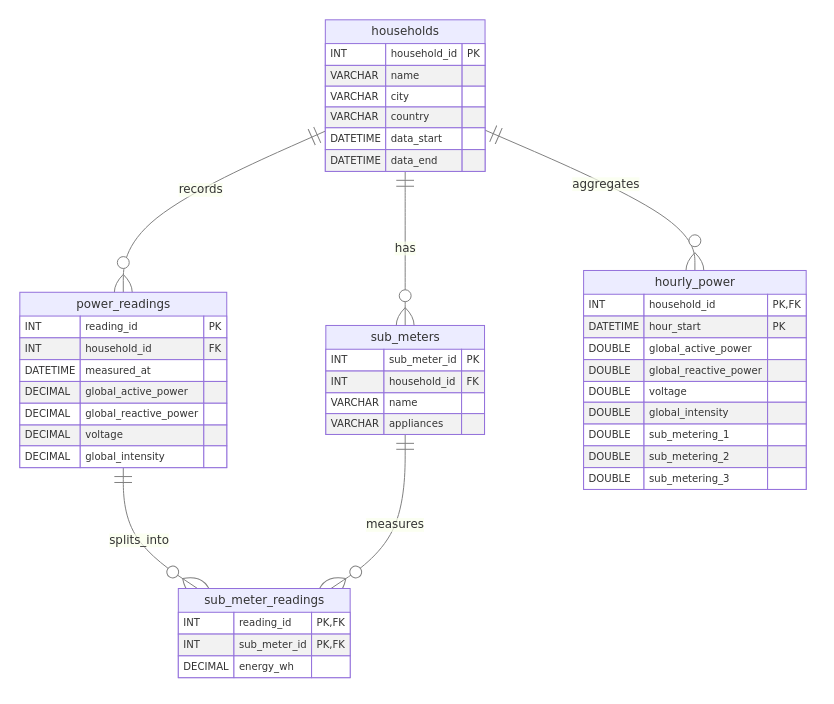

# Databases (Task 2)

The same dataset is stored in two databases:

- **MySQL**: the raw minute-level readings, normalised into 5 tables
- **MongoDB**: the same readings grouped into one document per day

Both run in Docker.

## Setup

```bash
# 1. Download the raw dataset (see the root README, "Getting the data")
# 2. Start the databases
docker compose -f db/docker-compose.yml up -d

# 3. Load the data (from the project root, with the venv active)
python -m scripts.load_mysql   # ~1 min
python -m scripts.load_mongo   # ~30 s
```

| Service | Host port | Credentials |
| --- | --- | --- |
| MySQL 8.4 | `3307` (override with `MYSQL_PORT`) | `power` / `powerpass`, database `household_power` |
| MongoDB 7 | `27017` | none, database `household_power` |

The MySQL schema (`mysql/schema.sql`) is applied automatically the first time the container starts. To start over from an empty database, run `docker compose -f db/docker-compose.yml down -v`.

### Without Docker (local MySQL and MongoDB)

These steps need MySQL 8+ and MongoDB 5+ installed and running, plus `mongosh`.

```bash
# 1. Create the schema and a user
mysql -u root -p < db/mysql/schema.sql
mysql -u root -p -e "CREATE USER IF NOT EXISTS 'power'@'localhost' IDENTIFIED BY 'powerpass';
                     GRANT ALL ON household_power.* TO 'power'@'localhost';"

# 2. Load the data. The loaders default to the Docker settings, so point them at the local servers
export MYSQL_PORT=3306                        # also MYSQL_HOST / MYSQL_USER / MYSQL_PASSWORD if yours differ
export MONGO_URI=mongodb://127.0.0.1:27017
python -m scripts.load_mysql
python -m scripts.load_mongo
```

To start over in MySQL, run `mysql -u root -p -e "DROP DATABASE household_power"`, then repeat step 1. The MongoDB loader drops and rebuilds its collections every time it runs.

## Relational schema (MySQL)



The Mermaid source is in [`erd.mmd`](erd.mmd), and the DDL is in [`mysql/schema.sql`](mysql/schema.sql).

| Table | Rows | Description |
| --- | --- | --- |
| `households` | 1 | The monitored house (Sceaux, France) and the date range of its data |
| `sub_meters` | 3 | Kitchen, laundry, and water heater + AC |
| `power_readings` | 2,075,259 | One row per minute. Missing values (`?` in the source) are stored as `NULL` |
| `sub_meter_readings` | 6,147,840 | Energy (Wh) for each reading and sub-meter. Minutes with missing values are skipped |
| `hourly_power` | 34,589 | Hourly aggregates from `data_analysis/data/processed/hourly_power.csv`, used for modelling |

Sub-metering is stored in its own table instead of three columns. Adding a meter then means adding a row, not changing the schema.

## MongoDB collection design

This design uses the **bucket pattern**: one document per household per day. It holds a precomputed `summary` and an embedded `readings` array with up to 1,440 minute readings. That gives 1,442 documents instead of 2M. A day's data comes back in a single read, and the daily-level queries only need the `summary` fields.

| Collection | Documents | Notes |
| --- | --- | --- |
| `households` | 1 | Household details, with the sub-meter definitions embedded |
| `daily_readings` | 1,442 | Has a JSON Schema validator, a unique index on `{household_id, date}` and an index on `summary.total_kwh` |

Sample documents: [`mongo/sample_documents.json`](mongo/sample_documents.json).

```json
{
  "household_id": 1,
  "date": "2007-01-01T00:00:00Z",
  "summary": {
    "minutes_recorded": 1440, "minutes_missing": 0,
    "total_kwh": 45.817, "avg_voltage": 240.13,
    "peak_power_kw": 3.558, "peak_time": "2007-01-01T09:50:00Z",
    "sub_metering_kwh": { "kitchen": 0, "laundry": 0.352, "water_heater_ac": 5.88 }
  },
  "readings": [
    { "time": "2007-01-01T00:00:00Z", "global_active_power": 2.58, "global_reactive_power": 0.136,
      "voltage": 241.97, "global_intensity": 10.6, "sub_metering_wh": [0, 0, 0] }
  ]
}
```

## Queries and results

Each database has four queries. The full output is in [`results/`](results/).

```bash
# Docker
docker exec -i power_mysql mysql -t -upower -ppowerpass --comments -v < db/mysql/queries.sql
docker exec power_mongo mongosh --quiet --eval "$(cat db/mongo/queries.js)"

# Local install
mysql -t -u power -p --comments -v < db/mysql/queries.sql
mongosh --quiet --file db/mongo/queries.js
```

### MySQL ([`mysql/queries.sql`](mysql/queries.sql), [results](results/mysql_results.txt))

1. **Daily energy for 1–7 Jan 2007**: between 16.9 and 54.3 kWh per day. 1 Jan 2007 used 45.82 kWh, which matches the MongoDB summary for that day.
2. **Average load by hour of day**: lowest around 04:00 (0.44 kW), with a morning peak at 07:00 (1.50 kW) and an evening peak at 20:00 (1.90 kW).
3. **Sub-meter share per year** (a 3-table JOIN with a window function): the water heater and AC account for 67–78% of sub-metered energy, and that share rises every year.
4. **Days with the most missing readings**: nine days have no data at all (1,440 missing minutes), including 18–21 Aug 2010.

### MongoDB ([`mongo/queries.js`](mongo/queries.js), [results](results/mongo_results.txt))

1. **One day's document** (`findOne` with `$slice`): the summary for 1 Jan 2007 plus its first 3 readings.
2. **Top 5 highest-consumption days** (sort on the indexed `summary.total_kwh`): 23 Dec 2006 used the most, at 79.6 kWh.
3. **Monthly average daily consumption in 2008** (`$group` aggregation): the January high is 35.0 kWh/day, and August drops to 6.6 kWh/day, probably while the household was on holiday.
4. **Minutes above 9 kW per year** (`$unwind` on the readings): 75 minutes in total, with the highest reading of 11.12 kW in 2009.
